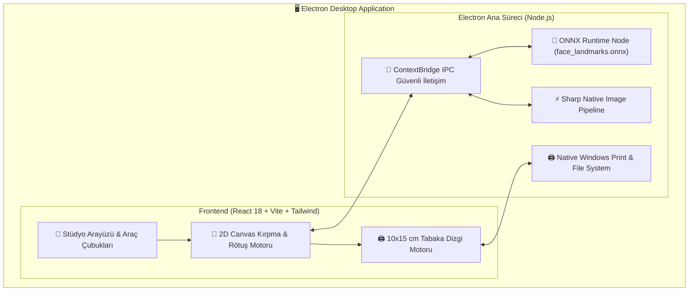

# 📸 BiyometrikPlus — Profesyonel Biyometrik & Vesikalık Fotoğraf Stüdyosu

<div align="center">


**Fotoğraf stüdyoları, matbaalar ve profesyonel fotoğrafçılar için yerel yapay zeka (ONNX) destekli, resmi Türk Biyometrik standartlarına tam uyumlu masaüstü biyometrik fotoğraf hazırlama ve 10×15 baskı şablonu istasyonu.**

</div>

---

## 📌 İçindekiler
- [Genel Bakış](#-genel-bakış)
- [Öne Çıkan Özellikler](#-öne-çıkan-özellikler)
- [Desteklenen Fotoğraf & Belge Standartları](#-desteklenen-fotoğraf--belge-standartları)
- [Masaüstü Mimarisi](#-masaüstü-mimarisi)
- [Kurulum & Çalıştırma](#-kurulum--çalıştırma)
  - [1. Hazır Kurulum Paketi (.exe Installer)](#1-hazır-kurulum-paketi-exe-installer)
  - [2. Kaynak Koddan Geliştirici Ortamı](#2-kaynak-koddan-geliştirici-ortamı)
  - [3. Windows Installer (.exe) Üretimi](#3-windows-installer-exe-üretimi)
- [Proje Dizin Yapısı](#-proje-dizin-yapısı)
- [Kullanılan Teknolojiler](#-kullanılan-teknolojiler)
- [Geliştirme & Katkı](#-geliştirme--katkı)
- [Lisans](#-lisans)

---

## 🌟 Genel Bakış

**BiyometrikPlus**, fotoğraf stüdyolarının geleneksel grafik programlarında cetvel ve kılavuz çizgileriyle harcadığı zamanı sıfıra indirmek üzere tasarlanmış modern bir masaüstü uygulamasıdır.

Masaüstünde tamamen **çevrimdışı (offline)** çalışan ONNX yapay zeka modeli sayesinde fotoğraftaki göz bebekleri, burun ucu, çene ve tepe noktalarını milisaniyeler içinde tespit ederek çene-tepe mesafesini resmi ICAO Doc 9303 ve Nüfus Müdürlüğü standartlarına otomatik olarak oturtur.

---

## ✨ Öne Çıkan Özellikler

### 1. 🧠 Yerel Yapay Zeka ile Otomatik Yüz & Biyometrik Hizalama
- **%100 Çevrimdışı ONNX Landmark Motoru:** Fotoğraflarınız hiçbir harici bulut sunucusuna gönderilmez; tüm yüz tespiti ve açı düzeltme bilgisayarınızın yerel donanımında gerçekleşir.
- **Otomatik Kırpma & Açı Dengeleme:** Eğik çekilmiş portreleri göz eksenine göre milimetrik olarak dengeler.
- **Dinamik Kılavuz Çizgileri:** Baş tepesi, göz ekseni ve çene kılavuzlarıyla operatöre anlık görsel doğrulama sunar.

### 2. 🖨️ Profesyonel 10×15 cm Baskı Tabakası Dizgisi
- Tek tıkla 10×15 cm fotoğraf kağıdına **2'li, 4'lü, 6'lı veya 8'li otomatik dizilim**.
- Kesim izi (crop marks), beyaz kenarlık ve giyotin kılavuz çizgileri.
- Doğrudan Windows yazdırma penceresine yüksek çözünürlüklü çıktı veya 300+ DPI kayıpsız JPEG/PNG/TIFF dışa aktarımı.

### 3. 🎨 Stüdyo Düzeyinde Hızlı Rötuş Araçları
- Pozlama (Exposure), Kontrast, Doygunluk (Saturation) ve Renk Sıcaklığı (Kelvin) ayarları.
- Cilt pürüzsüzleştirme ve leke temizleme fırçası.
- Fon parlatma / arka plan beyaz dengesi düzeltme.

### 4. ⚡ Yüksek Performanslı Native Görüntü İşleme
- Büyük boyutlu RAW veya yüksek çözünürlüklü JPEG portreleri **Sharp** kütüphanesiyle kayıpsız ve ultra hızlı işler.
- HTML5 Canvas 2D donanım hızlandırmalı gerçek zamanlı önizleme.

---

## 📋 Desteklenen Fotoğraf & Belge Standartları

| Belge Türü | Standart Ölçü | Çene-Tepe Mesafesi | 10×15 Tabaka Adedi | Standart & Açıklama |
| :--- | :--- | :--- | :--- | :--- |
| **TC Biyometrik (Pasaport / Ehliyet / Yeni Kimlik)** | **50 × 60 mm** | 32 - 36 mm | 4 Adet | ICAO Doc 9303 & NVİ standartları ile %100 uyumlu |
| **Vize & Uluslararası Biyometrik (Schengen / AB)** | **35 × 45 mm** | 32 - 36 mm | 8 Adet | Avrupa Birliği vize başvuru ölçüsü |
| **ABD Vizesi / Green Card** | **50 × 50 mm (2×2 inç)** | 25 - 35 mm | 4 Adet | Kare Amerikan vizesi standardı |
| **Standart Vesikalık** | **45 × 60 mm** | Serbest | 4 - 6 Adet | Kamu kurumları, okul ve genel başvurular |
| **Askeri Kimlik / TSK** | **25 × 32 mm** | 18 - 22 mm | 12 Adet | TSK ve askeri personel standartları |
| **Özel Boyut (Serbest Mod)** | Operatör Tanımlı | İsteğe Bağlı | Otomatik Dizin | Stüdyo özel ebatları için milimetrik ayar |

---

## 🏗️ Masaüstü Mimarisi



---

## 🚀 Kurulum & Çalıştırma

### 1. Hazır Kurulum Paketi (.exe Installer)
Uygulamayı derlemeden doğrudan kurmak için:
1. `release/BiyometrikPlus-Kurulum-v2.4.0.exe` kurulum dosyasını çalıştırın.
2. Kurulum sihirbazı masaüstü ve başlat menüsü kısayolunu oluşturacaktır.
3. Uygulama tamamen bağımsız ve çevrimdışı olarak çalışmaya hazırdır.

---

### 2. Kaynak Koddan Geliştirici Ortamı

#### Sistem Gereksinimleri
- **Node.js**: v18.0.0 veya üzeri (v20+ LTS önerilir)
- **npm**: v9.0.0 veya üzeri
- **İşletim Sistemi**: Windows 10 / 11 (x64)

#### Adım 1: Depoyu Klonlayın
```bash
git clone https://github.com/erolia/biyometrik-plus.git
cd biyometrik-plus
```

#### Adım 2: Bağımlılıkları Yükleyin
```bash
npm install
```

#### Adım 3: Geliştirici Modunda Başlatın
Vite ve Electron eşzamanlı olarak geliştirici modunda ayağa kalkar:
```bash
npm run electron:dev
```

Yalnızca kullanıcı arayüzünü tarayıcı üzerinde test etmek isterseniz:
```bash
npm run dev
```

---

### 3. Windows Installer (.exe) Üretimi

Uygulamanın `NSIS` tabanlı bağımsız Windows kurulum paketini derlemek için:

```bash
npm run dist
```

Derleme tamamlandığında çıktılar `release/` dizininde üretilir:
- `release/BiyometrikPlus-Kurulum-v2.4.0.exe` (Tek tıkla kurulabilir paket)
- `release/win-unpacked/` (Doğrudan çalıştırılabilir taşınabilir klasör)

---

## 📁 Proje Dizin Yapısı

```
photoid/
├── build/                         # Windows kurulum ve uygulama ikonları
│   ├── icon.ico                   # Çoklu çözünürlük Windows uygulama ikonu
│   └── icon.png                   # 512x512 kaynak ikon görseli
├── electron/                      # Electron Ana Süreçleri
│   ├── main.cjs                   # Pencere yönetimi, IPC ve menü konfigürasyonu
│   ├── preload.cjs                # Güvenli ContextBridge API köprüsü
│   └── onnx-service.cjs           # Yerel ONNX model yükleme ve inferans servisi
├── models/                        # Yerel Yapay Zeka Modelleri
│   └── face_landmarks.onnx        # Çevrimdışı yüz landmark tespit modeli
├── src/                           # React + TypeScript Kullanıcı Arayüzü
│   ├── components/                # Modüler UI bileşenleri
│   │   ├── EditorCanvas.tsx       # Biyometrik kılavuz, kırpma & önizleme motoru
│   │   ├── ExportModal.tsx        # Baskı ve dışa aktarma penceresi
│   │   ├── PaperGrid.tsx          # 10x15 cm baskı kağıdı dizgi önizleyicisi
│   │   ├── RetouchToolbar.tsx     # Pozlama, kontrast ve rötuş araçları
│   │   └── Sidebar.tsx            # Fotoğraf listesi ve standart seçici
│   ├── types/                     # TypeScript arayüz ve tip tanımları
│   ├── App.tsx                    # Ana React bileşeni
│   └── main.tsx                   # React DOM giriş noktası
├── package.json                   # Bağımlılıklar, scriptler ve build ayarları
├── tsconfig.json                  # TypeScript derleyici yapılandırması
└── vite.config.ts                 # Vite derleyici ayarları
```

---

## 🛠️ Kullanılan Teknolojiler

- **Masaüstü Motoru:** [Electron 33](https://www.electronjs.org/)
- **Kullanıcı Arayüzü:** [React 18](https://react.dev/), [TypeScript 5](https://www.typescriptlang.org/), [Tailwind CSS 3](https://tailwindcss.com/)
- **İkon Seti:** [Lucide React](https://lucide.dev/)
- **Yapay Zeka & Görüntü İşleme:** [ONNX Runtime Node](https://onnxruntime.ai/), [Sharp](https://sharp.pixelplumbing.com/)
- **Paketleyici:** [Electron Builder](https://www.electron.build/) (NSIS Windows x64)

---

## 🤝 Geliştirme & Katkı

Projeye katkıda bulunmak isterseniz:

1. Bu depoyu Fork edin.
2. Yeni bir dal açın: `git checkout -b feature/yeni-ozellik`
3. Değişikliklerinizi commit edin: `git commit -m 'feat: yeni özellik eklendi'`
4. Dalınızı uzak depoya gönderin: `git push origin feature/yeni-ozellik`
5. Bir **Pull Request (PR)** oluşturun.

---

## 📄 Lisans

Bu proje özel bir mülkiyettir. Tüm hakları saklıdır.  
Telif Hakkı © 2026 **Erolia**.
