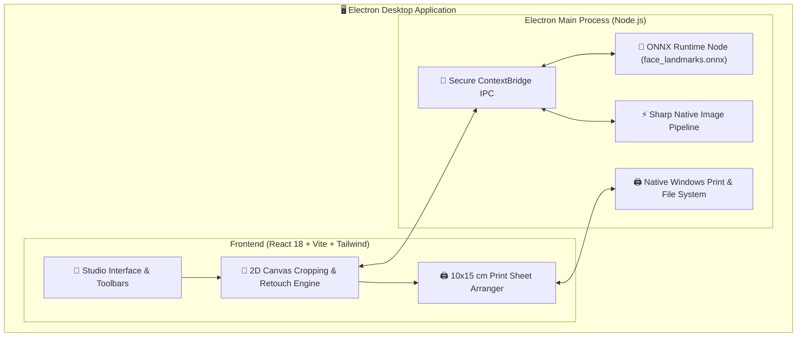

# 📸 BiyometrikPlus — Professional Biometric & Passport Photo Studio

<div align="center">

[🇹🇷 Türkçe](README.md) • **🇬🇧 English**

<br/>


**A professional desktop workstation for photo studios, print shops, and photographers featuring local offline AI (ONNX) face landmark detection, full compliance with ICAO Doc 9303 standards, and automatic 10×15 cm (4×6") print sheet layouts.**

<br/>

[-2ea44f?style=for-the-badge&logo=windows&logoColor=white)](https://github.com/eroliaweb/biyometrik-plus/releases/latest)
[](https://github.com/eroliaweb/biyometrik-plus/releases)

</div>

> [!IMPORTANT]
> ### 💸 Stop Paying $100+/Month — Same Studio Quality, 100% Free Forever!
> While commercial passport photo and studio software lock photographers into **$50 – $100 / month (3,000 TL/month)** expensive subscriptions, **BiyometrikPlus** delivers the exact same professional quality, official ICAO Doc 9303 standards, and offline AI tools **completely free of charge**.
> 
> - ❌ No monthly or annual subscription fees
> - ❌ No pay-per-photo credits or export limits
> - ❌ No hidden license locks or paywalls
> - ✅ Download, install, and use without limitations forever!

---

## 📌 Table of Contents
- [Overview](#-overview)
- [Key Features](#-key-features)
- [Supported Document & Photo Standards](#-supported-document--photo-standards)
- [Desktop Architecture](#-desktop-architecture)
- [Installation & Quick Start](#-installation--quick-start)
  - [1. Windows Standalone Installer (.exe)](#1-windows-standalone-installer-exe)
  - [2. Running from Source (Developer Setup)](#2-running-from-source-developer-setup)
  - [3. Building the Windows Installer (.exe)](#3-building-the-windows-installer-exe)
- [Project Directory Structure](#-project-directory-structure)
- [Tech Stack](#-tech-stack)
- [Contributing](#-contributing)
- [License](#-license)

---

## 🌟 Overview

**BiyometrikPlus** is designed to eliminate the manual, error-prone workflow of measuring and cropping biometric photos with guides and rulers in traditional graphic editors.

Powered by a completely **offline ONNX AI model**, it detects facial landmarks (pupils, nose tip, chin, and top of the head) in milliseconds. It automatically aligns the subject, corrects head tilt, and scales the chin-to-crown distance to strictly match official ICAO Doc 9303 and international passport/ID specifications.

---

## ✨ Key Features

### 1. 🧠 100% Offline AI Face Landmark Alignment
- **Zero Cloud Dependence:** Photos are processed 100% locally on your machine. No images are ever uploaded to remote servers, ensuring strict privacy and GDPR/KVKK compliance.
- **Automatic Crop & Tilt Correction:** Automatically calculates the eye axis angle and levels tilted portraits down to the millimeter.
- **Dynamic Overlay Guides:** Live visual guides indicating crown limit, eye axis, and chin line for instant operator verification.

### 2. 🖨️ Professional 10×15 cm (4×6") Print Sheet Generator
- Instant single-click layout for **2, 4, 6, or 8 photos per 10×15 sheet**.
- Configurable cutting lines (crop marks), white borders, and guillotine margins.
- Direct output to native Windows print dialogue or lossless export in JPEG, PNG, or TIFF at 300+ DPI.

### 3. 🎨 Rapid Studio Retouching Tools
- Exposure, Contrast, Saturation, and Color Temperature (Kelvin) sliders.
- Skin smoothing brush and spot blemish remover.
- Background lightening and pure white balance equalization.

### 4. ⚡ High-Performance Native Pipeline
- Powered by **Sharp** (libvips) for ultra-fast, lossless handling of high-resolution camera imports.
- Hardware-accelerated HTML5 Canvas 2D engine for smooth, lag-free real-time rendering.

---

## 📋 Supported Document & Photo Standards

| Document Type | Standard Size | Chin-to-Crown Distance | 10×15 Print Count | Description & Standards |
| :--- | :--- | :--- | :--- | :--- |
| **Turkish Biometric (Passport / ID / Driver's License)** | **50 × 60 mm** | 32 - 36 mm | 4 Copies | Fully compliant with NVİ & ICAO Doc 9303 |
| **Schengen / EU Visa & Passport** | **35 × 45 mm** | 32 - 36 mm | 8 Copies | Standard European Union visa/passport format |
| **US Visa / Green Card (2×2 inch)** | **50 × 50 mm** | 25 - 35 mm | 4 Copies | Official square US Department of State standard |
| **Standard Portrait / Vesikalık** | **45 × 60 mm** | Free | 4 - 6 Copies | General institutional & school applications |
| **Military ID (TSK)** | **25 × 32 mm** | 18 - 22 mm | 12 Copies | Armed forces personnel identification standard |
| **Custom Size (Free Studio Mode)** | User-defined | Configurable | Auto Grid | Millimetric custom dimensions for studio needs |

---

## 🏗️ Desktop Architecture



---

## 🚀 Installation & Quick Start

### 1. Windows Standalone Installer (.exe)
To install without building from source:
1. Download the latest installer from [Releases](https://github.com/eroliaweb/biyometrik-plus/releases/latest).
2. Run `BiyometrikPlus-Kurulum-v2.4.0.exe`.
3. The wizard will create desktop and start menu shortcuts.
4. Launch the application; it is ready to use completely offline.

---

### 2. Running from Source (Developer Setup)

#### Requirements
- **Node.js**: v18.0.0 or higher (v20+ LTS recommended)
- **npm**: v9.0.0 or higher
- **Operating System**: Windows 10 / 11 (x64)

#### Step 1: Clone the Repository
```bash
git clone https://github.com/eroliaweb/biyometrik-plus.git
cd biyometrik-plus
```

#### Step 2: Install Dependencies
```bash
npm install
```

#### Step 3: Start in Development Mode
Launches Vite and Electron concurrently with live reload:
```bash
npm run electron:dev
```

If you only want to preview the UI in a web browser:
```bash
npm run dev
```

---

### 3. Building the Windows Installer (.exe)

To generate a standalone NSIS installer package for Windows:

```bash
npm run dist
```

Upon completion, build artifacts will be located in the `release/` folder:
- `release/BiyometrikPlus-Kurulum-v2.4.0.exe` (Single-click setup installer)
- `release/win-unpacked/` (Portable standalone folder)

---

## 📁 Project Directory Structure

```
photoid/
├── build/                         # Windows installer and app icons
│   ├── icon.ico                   # Multi-resolution Windows application icon
│   └── icon.png                   # 512x512 high-res source icon
├── electron/                      # Electron Main Processes
│   ├── main.cjs                   # Window lifecycle, IPC handlers, app menu
│   ├── preload.cjs                # Secure ContextBridge API bridge
│   └── onnx-service.cjs           # Local ONNX model loader and inference engine
├── models/                        # Offline AI Models
│   └── face_landmarks.onnx        # Local landmark detection model
├── src/                           # React + TypeScript Frontend
│   ├── components/                # Modular UI components
│   │   ├── EditorCanvas.tsx       # Biometric guide overlay, cropping & canvas engine
│   │   ├── ExportModal.tsx        # High-DPI export and print preview modal
│   │   ├── PaperGrid.tsx          # 10x15 cm sheet arrangement visualizer
│   │   ├── RetouchToolbar.tsx     # Color, exposure, contrast, and retouch tools
│   │   └── Sidebar.tsx            # Photo drawer & standard selector
│   ├── types/                     # TypeScript type definitions
│   ├── App.tsx                    # Root application component
│   └── main.tsx                   # React DOM entry point
├── package.json                   # Dependencies, scripts, and build configuration
├── tsconfig.json                  # TypeScript compiler configuration
└── vite.config.ts                 # Vite bundler configuration
```

---

## 🛠️ Tech Stack

- **Desktop Framework:** [Electron 33](https://www.electronjs.org/)
- **UI Framework:** [React 18](https://react.dev/), [TypeScript 5](https://www.typescriptlang.org/), [Tailwind CSS 3](https://tailwindcss.com/)
- **Icon Set:** [Lucide React](https://lucide.dev/)
- **AI & Native Image Pipeline:** [ONNX Runtime Node](https://onnxruntime.ai/), [Sharp](https://sharp.pixelplumbing.com/)
- **Packaging:** [Electron Builder](https://www.electron.build/) (NSIS Windows x64)

---

## 🤝 Contributing

Contributions are welcome! Please follow these steps:

1. Fork this repository.
2. Create a new branch: `git checkout -b feature/your-feature-name`
3. Commit your changes: `git commit -m 'feat: add some feature'`
4. Push to your branch: `git push origin feature/your-feature-name`
5. Open a **Pull Request (PR)**.

---

## 📄 License

Proprietary software. All rights reserved.  
Copyright © 2026 **Erolia**.
